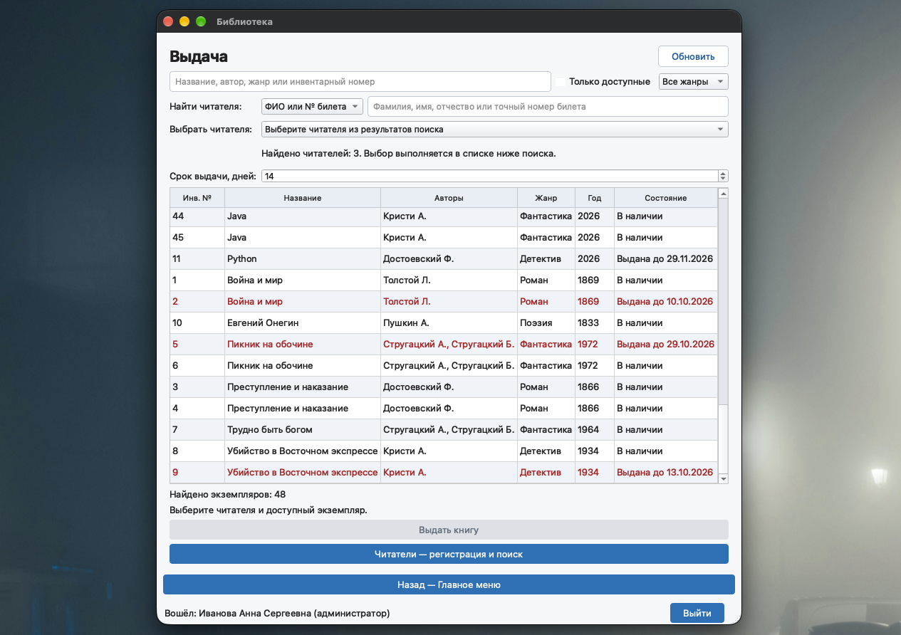

# Library

A desktop app for managing books, readers, loans, and reports, built with PyQt6 and SQLite.



## Run

Requires Python 3.10+.

```sh
python3 -m venv .venv
source .venv/bin/activate
python -m pip install -r requirements.txt
python main.py
```

On Windows, use `python` to create the environment and activate it with `.\.venv\Scripts\Activate.ps1`.

Demo logins are `admin / 1234` and `lib / 1111`.

In **Отчёты → Формуляр книги**, choose an inventory number to see that copy’s loan and return history.
